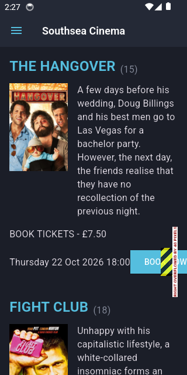
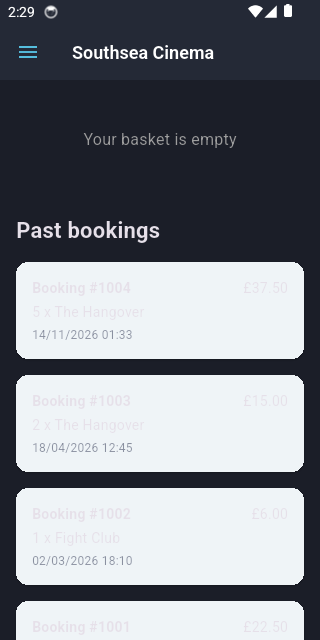

# Southsea Cinema

A Flutter app for browsing films at Southsea Cinema, booking tickets and
viewing past bookings. The app is set up for Android only.

## Features

- Browse the current films, loaded from a bundled JSON file.
- Open a film to see its showtimes, choose up to five tickets and see the
  subtotal.
- Review the basket, remove tickets and check out.
- Save each checkout as a numbered booking with its films, ticket prices
  and quantities, and list past bookings under the basket. Bookings are
  stored locally in SQLite; the basket is held in memory.
- Save customer profile details and a newsletter choice on the device.
- Switch between light and dark mode. The choice is saved on the device.

## Platform

The app runs on Android only, because it saves bookings in a SQLite
database file on the device. Use an Android emulator or a physical Android
device. Running it in a browser or on a desktop is not supported.

## Getting started

### Prerequisites

- [Flutter](https://docs.flutter.dev/get-started/install) with the Android
  toolchain set up.
- An Android emulator or device.
- Git.

### Clone

```bash
git clone https://github.com/IoannisMich/southsea_cinema.git
cd southsea_cinema
```

### Install dependencies

```bash
flutter pub get
```

### Run

Start an Android emulator or connect a device, then run:

```bash
flutter run
```

## Tests

Run the automated unit and widget tests with:

```bash
flutter test
```

These tests use in-memory SQLite databases and in-memory preferences, so
they do not require an Android emulator. Running the app itself does
require an Android emulator or device.

To measure test coverage, run `flutter test --coverage`. The report is
written to `coverage/lcov.info`.

Line coverage went from 85.9% to 96.9% after adding tests for the film
page, film card and navigation drawer.

## Project structure

- `lib/models/` holds the data classes, such as `Movie`, `TicketItem`,
  `Booking` and `UserSettings`.
- `lib/repositories/` holds the film loader and the in-memory basket.
- `lib/database/` holds the SQLite database for saved bookings.
- `lib/views/` holds the home, film, basket and settings pages.
- `lib/widgets/` holds the reusable button, film card and drawer.
- `assets/data/` holds the film catalogue as JSON.
- `test/` mirrors the folders in `lib/`.

## Screenshots

### Home

The home page lists the current films with their showtimes and prices.



### Basket

The basket shows the selected tickets, the total and past bookings.


